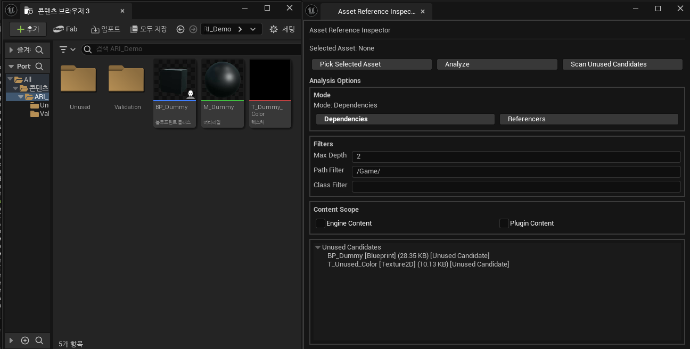
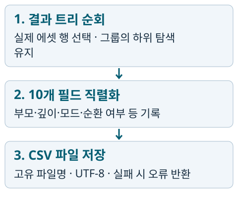

# Asset Reference Inspector

에셋 참조 관계와 미사용 후보를 탐색하고, 분석 결과를 CSV로 저장하는 UE5.4 에디터 플러그인입니다.

[프로젝트 웹 페이지](https://razria93.github.io/site/plugin.html) · [프로젝트 PDF](https://razria93.github.io/files/pdf/plugin-review.pdf) · [시연·검증 자료](https://razria93.github.io/site/details/Plugin_Portfolio_UE5.4/portfolio-evidence/index.html)

[개요](#overview) · [기여](#contribution) · [주요 기능](#features) · [핵심 구현](#implementation) · [문제 해결](#troubleshooting) · [검증·한계](#verification) · [실행 방법](#getting-started)



*2026.07 개발 당시 화면 · 미사용 후보 조회와 원본 위치 이동. 별도 2026.10 추가 QA와 구분합니다.*

<a id="asset-reference-inspector-ue5-에셋-참조-분석-도구"></a>
<a id="프로젝트-정보"></a>
<a id="overview"></a>

## 프로젝트 개요

| 항목 | 내용 |
| --- | --- |
| 목적·성격 | Unreal Editor Tool 제작 학습 · 에셋 참조 분석용 Editor Plugin |
| 기간 | 2026.07.13–07.20 · 적용·제출 정리 포함. Demo Host 기능 개발 기록은 07.19까지 |
| 개발·작업 형태 | 1인 개발 · Codex 활용. 실제 작업 범위는 아래 기여 설명 참고 |
| 주요 기능 | Dependencies / Referencers 조회, 공유·순환 처리, 미사용 후보 탐색, CSV 저장 |
| 구현·정리 범위 | 독립 플러그인과 개발·검증용 Demo Host, 실제 Portfolio 프로젝트 적용 기록 |
| 기술 | C++ · Unreal Editor Module · Asset Registry · Slate · Content Browser API |
| 실행 환경 | Unreal Engine 5.4 · Visual Studio C++ 개발 환경 · Editor Target |
| 결과 확인 | Demo Host 실행 또는 다른 프로젝트에 플러그인 적용. 두 실행 경로를 구분 |

<a id="contribution"></a>

## 작업 범위·기여

**사용자 작업:** 개발 목표·작업 단위·문서 운영 기준과 우선순위를 정하고 기능 요구를 검토했습니다. 입력 오류를 발견해 조작별 로그를 제공하고 탐색 범위 변경을 제안했습니다. CSV 리뷰 사례에서는 환경 대응과 수정 후 커밋·리뷰 절차도 진행했습니다.

**Codex 작업:** 초기 계획·작업 지침, 코드 분석·구현·수정, 빌드·자동 리뷰 및 별도 환경의 추가 QA·자료 정리를 수행했습니다.

**미사용 후보는 삭제 안전 판정이 아닙니다.** 표시 크기는 디스크 파일 기준 추정값이며 런타임 메모리가 아닙니다. 2026.10.21 Data Asset 추가 QA를 7월 개발 당시 확인이나 사용자 기여로 소급하지 않습니다.

<a id="대표-검증-영상"></a>
<a id="대표-화면시연"></a>
<a id="features"></a>

## 주요 기능·실행 결과

Content Browser에서 선택한 에셋의 Dependencies / Referencers를 Slate Tree View로 표시합니다. 원본 위치 이동과 CSV 저장으로 분석 결과를 확인하고, 선택 에셋과 무관한 미사용 후보 스캔을 별도로 제공합니다.

| 기능 | 확인할 내용 | 자료 |
| --- | --- | --- |
| 참조 관계 탐색 | 공유 에셋의 경로별 표시, 순환 경로의 추가 탐색 중단 | [프로젝트 PDF · 13쪽](https://razria93.github.io/files/pdf/plugin-review.pdf#page=13) · [시연 영상 · 약 1분 14초](https://razria93.github.io/site/details/Plugin_Portfolio_UE5.4/portfolio-evidence/index.html#case1) |
| 미사용 후보 탐색 | `/Game` 아래 독립 스캔·필터·원본 위치 이동 | [프로젝트 PDF · 12쪽](https://razria93.github.io/files/pdf/plugin-review.pdf#page=12) · [개발 당시 자료](https://razria93.github.io/site/details/Plugin_Portfolio_UE5.4/portfolio-evidence/index.html#unused) |
| CSV 저장 | 화면의 에셋·부모·깊이·모드를 파일에 기록 | [프로젝트 PDF · 14쪽](https://razria93.github.io/files/pdf/plugin-review.pdf#page=14) · [화면·CSV 대응](https://razria93.github.io/site/details/Plugin_Portfolio_UE5.4/portfolio-evidence/index.html#csv-export) |

대표 참조 관계 영상은 2026.10 별도 Data Asset의 hard reference 추가 QA입니다. 개발 당시 Blueprint·실제 프로젝트 전체 재실행과 구분합니다. 미사용 후보는 삭제 안전 판정이 아니며, 표시 크기는 런타임 메모리·cooked size·의존성을 합친 크기가 아닌 디스크 파일 추정값입니다.

<a id="implementation"></a>

<a id="대표-구현"></a>

## 핵심 구현·작업 과정

<a id="참조-관계공유순환-처리_1"></a>

### 참조 관계·공유·순환 처리

**목적:** 같은 에셋이 여러 경로에 나타나는 공유 관계와 같은 경로를 다시 도는 순환 관계를 구분하여 탐색합니다.

**처리 흐름·설계 이유:** Asset Registry의 `FAssetData`와 PackageName을 기준으로 Dependencies / Referencers를 조회합니다. Max Depth에 맞춰 Tree를 구성하고, 공유 에셋은 각 경로에 남깁니다. 같은 경로에서 다시 만난 에셋은 순환으로 표시하고 하위 탐색을 중단합니다.

**확인 결과:** 별도 Data Asset QA에서 공유 경로 유지와 순환 탐색 중단을 확인했습니다.

**조건·한계:** hard reference 범위의 확인입니다. 당시 Blueprint·실제 프로젝트 전체 재실행, 크래시·성능 실측은 수행하지 않았습니다. Soft Reference·Manage Dependency는 별도 UI 옵션으로 분리하지 않으며 동적 로딩·문자열 경로·Asset Manager 규칙을 완전하게 추적한다고 보장하지 않습니다.

**관련 자료:** [프로젝트 PDF · 13쪽](https://razria93.github.io/files/pdf/plugin-review.pdf#page=13) · [공유·순환 검증](https://razria93.github.io/site/details/Plugin_Portfolio_UE5.4/portfolio-evidence/index.html#case1) · [분석 UI·탐색 코드](https://github.com/Razria93/Plugin_Portfolio_UE5.4/blob/main/Plugins/AssetReferenceInspector/Source/AssetReferenceInspector/Private/UI/SAssetReferenceInspectorWidget.cpp)

### 선택 없이 미사용 후보 탐색

**목적:** 선택한 에셋의 관계 목록 밖에서도 검토할 후보를 찾습니다.

**처리 흐름·설계 이유:** `/Game` 및 하위 폴더에서 `GetReferencers()` 결과가 0개인 에셋을 탐색하고 폴더·종류 필터를 적용합니다. 결과의 노드를 더블 클릭해 원본 위치로 이동할 수 있습니다.

**확인 결과:** 개발 당시 조회·필터·원본 위치 이동을 확인했습니다. 새 10월 추가 QA 사례는 아닙니다.

**조건·한계:** 미사용 후보는 삭제 가능 판정이 아닙니다. Soft Reference·Asset Manager·동적 로딩 기반 실제 사용 여부는 검증하지 않았습니다.

**관련 자료:** [프로젝트 PDF · 12쪽](https://razria93.github.io/files/pdf/plugin-review.pdf#page=12) · [개발 당시 화면·기록](https://razria93.github.io/site/details/Plugin_Portfolio_UE5.4/portfolio-evidence/index.html#unused)

### 분석 결과 CSV 저장

**목적:** 화면에서 확인한 참조 관계를 외부에서도 검토할 수 있도록, 부모·깊이·모드 등 분석 맥락을 함께 파일로 남깁니다.



*CSV Exporter 코드에 근거한 핵심 경로 요약. 저장 오류와 수량 해석은 아래 조건을 함께 확인합니다.*

**처리 흐름·설계 이유**

1. 결과 트리를 재귀 순회하고 패키지 이름이 있는 실제 에셋만 행으로 만듭니다. 안내·그룹 행은 제외하지만 그 하위 항목은 계속 탐색합니다.
2. 에셋·부모·깊이·분석 모드·순환 여부 등을 10개 필드로 저장합니다. 쉼표·따옴표·줄바꿈을 처리하여 CSV 구조를 유지합니다.
3. `Saved/AssetReferenceInspector`에 충돌을 피한 파일명으로 UTF-8(BOM 없음) CSV를 저장합니다. 에셋 행이 없거나 디렉터리 생성·파일 저장에 실패하면 오류를 반환합니다.

**확인 결과:** 개발 당시 분석 화면과 CSV에 에셋·깊이·모드가 대응하는 자료가 남아 있습니다. Exporter와 UI 연결, 직렬화·저장 규칙을 분리해 설명합니다.

**조건·한계:** CSV 행 수는 결과 범위를 확인하는 값이며 고유 에셋 수나 성능을 뜻하지 않습니다. 같은 에셋도 경로에 따라 표시될 수 있습니다. 표시 크기는 디스크 추정값입니다. 개발 당시 자료와 별도 Data Asset QA를 구분하며, 다른 UE 버전·대규모 성능·모든 참조 유형의 완전성은 미검증입니다.

**관련 자료:** [프로젝트 PDF · 14쪽](https://razria93.github.io/files/pdf/plugin-review.pdf#page=14) · [CSV 형식·저장 규칙](https://github.com/Razria93/Plugin_Portfolio_UE5.4/blob/main/Docs/02_Architecture/CSV_Export_Format_KR.md) · [화면·CSV 대응](https://razria93.github.io/site/details/Plugin_Portfolio_UE5.4/portfolio-evidence/index.html#csv-export) · [CSV Exporter 코드](https://github.com/Razria93/Plugin_Portfolio_UE5.4/blob/724eaba9790859066d7b34baf48c5efd7a9f877e/Plugins/AssetReferenceInspector/Source/AssetReferenceInspector/Private/Export/AssetReferenceCsvExporter.cpp#L9-L51)

<a id="troubleshooting"></a>

## 문제 해결

<a id="필터-입력-오류"></a>

### Enter 확정 후 사라지는 필터 경로

**증상·영향:** 폴더 경로를 입력하고 Enter로 확정하면 경로가 지워져, 지정 범위 밖의 항목까지 분석됐습니다.

**원인·근거:** Enter 확정 뒤 호출된 `OnCleared` 처리에서 저장 경로를 빈 값으로 덮어썼습니다. 사용자가 제공한 조작별 로그와 입력 콜백을 대조했습니다.

**수정·선택 이유:** `OnCleared`에서는 저장 경로를 바꾸지 않고 반환합니다. Enter·클릭 확정 때 경로를 저장하여 입력 확정과 후속 해제 이벤트를 구분합니다.

**검증·결과**

| 확인 방법 | 확인한 결과 |
| --- | --- |
| Enter · 이전 입력 콜백 재구성 비교 | 수정 전 CSV 10행 → 수정 후 2행(시작 에셋 A + BranchB의 B). A는 필터와 무관하게 포함 |
| 클릭 확정 · 수정 후 확인 | C 경로 유지 · A와 C 출력 |
| Escape · 수정 후 확인 | B로 편집하던 입력 취소 → 기존 C 복원 · CSV도 기존 C 결과와 동일 |
| 빈 입력 후 Enter · 수정 후 확인 | 필터 해제 · 결과 10행 |

**조건·한계:** 2026.10.21 Codex가 실행한 별도 UE5.4 Data Asset QA입니다. 이전 처리 비교는 Enter 조건에 한정하며 과거 전체 빌드 비교가 아닙니다. 다른 세 조건은 수정 후 동작 확인입니다. 개발 당시 사용자의 오류 발견·로그 제공·Escape 확인과 이후 Codex의 추가 QA를 구분합니다. 다른 UE 버전이나 당시 Blueprint·실제 프로젝트 전체를 재실행한 결과는 아닙니다.

**관련 자료:** [프로젝트 PDF · 5–7쪽](https://razria93.github.io/files/pdf/plugin-review.pdf#page=5) · [입력 조건별 검증·영상·CSV](https://razria93.github.io/site/details/Plugin_Portfolio_UE5.4/portfolio-evidence/index.html#case2) · [입력 확정 코드](https://github.com/Razria93/Plugin_Portfolio_UE5.4/blob/724eaba9790859066d7b34baf48c5efd7a9f877e/Plugins/AssetReferenceInspector/Source/AssetReferenceInspector/Private/UI/SAssetReferenceInspectorWidget.cpp#L393-L402)

<a id="미사용-후보-탐색탐색-범위-재설계"></a>

### 미사용 후보 탐색 범위 변경

**증상·영향:** 선택한 에셋의 참조 관계만으로는 관계 밖에 있는 미사용 후보를 찾기 어려웠습니다.

**원인·근거:** 관계 탐색 결과와 독립적인 미사용 후보 탐색의 목적·범위가 달랐습니다.

**수정·선택 이유:** 사용자가 탐색 범위 변경을 제안했고, 선택 에셋과 무관하게 `/Game` 및 하위 폴더를 스캔하는 경로로 변경했습니다.

**검증·결과:** 개발 당시 조회·필터·원본 위치 이동 기록으로 확인합니다. 별도 10월 Data Asset QA를 추가 실행한 사례로 표현하지 않습니다.

**조건·한계:** `GetReferencers()` 결과가 없다는 사실이 실제 미사용이나 삭제 안전성을 보장하지 않습니다. 동적 로딩·Asset Manager·Soft Reference 사용 여부는 별도 확인이 필요합니다.

**관련 자료:** [프로젝트 PDF · 8–10쪽](https://razria93.github.io/files/pdf/plugin-review.pdf#page=8) · [개발 당시 확인·기여](https://razria93.github.io/site/details/Plugin_Portfolio_UE5.4/portfolio-evidence/index.html#unused)

<a id="csv-저장모드-불일치"></a>

### CSV 저장 모드 불일치

**증상·영향:** 결과를 만든 뒤 분석 모드 버튼을 바꾸면 화면 결과와 CSV에 기록한 모드가 어긋날 수 있었습니다.

**원인·근거:** PR #59의 Codex 자동 리뷰에서 현재 UI 모드와 결과 생성 당시 분석 모드를 혼용하는 문제를 발견했습니다.

**수정·선택 이유:** CSV는 현재 버튼 값이 아니라 결과 생성 당시 분석 모드를 사용하도록 보완했습니다. 사용자는 리뷰 범위를 확인하고 Live Coding 해제 등 환경 대응과 수정 후 커밋·리뷰 대응 절차를 진행했습니다. 결함 발견·코드 수정·빌드는 Codex 작업과 구분합니다.

**검증·결과:** 개발 당시 수정 코드의 빌드를 확인했고, 10월 별도 Data Asset QA에서 양방향 모드 전환 후 화면·CSV 대응을 확인했습니다.

**조건·한계:** 과거 전체 빌드 비교가 아닙니다. CSV 행 수는 결과 범위를 확인하는 값이지 성능이나 고유 에셋 수가 아닙니다. 자동 리뷰 발견을 사용자의 직접 발견으로 바꾸지 않습니다.

**관련 자료:** [프로젝트 PDF · 15쪽](https://razria93.github.io/files/pdf/plugin-review.pdf#page=15) · [모드 전환·화면·CSV](https://razria93.github.io/site/details/Plugin_Portfolio_UE5.4/portfolio-evidence/index.html#case3)

<a id="공통-해석-범위"></a>
<a id="verification"></a>

<a id="검증-조건한계"></a>

## 검증 범위·알려진 한계

2026.07 개발·적용 기록과 2026.10.21 별도 UE5.4 Data Asset 추가 QA를 구분합니다. 입력 오류의 이전 처리 비교는 재구성한 Enter 조건에 한정합니다. 공유·순환 확인은 hard reference 조건이며 다른 UE 버전·대규모 성능·모든 참조 유형의 완전성은 미검증입니다.

이 도구는 Editor 전용 Project Plugin입니다. 게임 런타임 기능이나 삭제 자동화 도구가 아니며 Node Graph UI는 향후 작업으로 남아 있습니다. 기능 구현과 검증 완료 범위를 동일하게 취급하지 않습니다.

[개발 당시 확인·추가 QA·미검증 범위](https://razria93.github.io/site/details/Plugin_Portfolio_UE5.4/portfolio-evidence/development/verification_scope/index.html)

<a id="local-run"></a>
<a id="빌드사용-방법"></a>

<a id="getting-started"></a>

<a id="로컬-실행"></a>

## 실행 환경·시작 방법

<a id="저장소환경-준비"></a>

### 준비·실행 경로 선택

Windows, Unreal Engine 5.4, Visual Studio C++ 개발 환경을 준비합니다. 저장소 안의 Demo Host 실행과 기존 프로젝트에 플러그인 적용은 서로 다른 경로입니다.

```powershell
git clone https://github.com/Razria93/Plugin_Portfolio_UE5.4.git
cd Plugin_Portfolio_UE5.4
```

<a id="기본-사용-흐름"></a>
<a id="에디터에서-실행"></a>

### A. Demo Host 실행

저장소 루트에서 엔진 설치 경로를 맞춘 뒤 Editor Target을 빌드합니다.

```powershell
$engineRoot = 'C:\Program Files\Epic Games\UE_5.4'
$projectPath = (Resolve-Path -LiteralPath '.\Portfolio_PlugIn.uproject').Path
& "$engineRoot\Engine\Build\BatchFiles\Build.bat" Portfolio_PlugInEditor Win64 Development "-Project=$projectPath" -WaitMutex -FromMsBuild
```

1. `Portfolio_PlugIn.uproject`를 엽니다.
2. `Window > Asset Reference Inspector`를 엽니다.
3. Content Browser에서 에셋을 선택하고 `Pick Selected Asset`을 누릅니다.
4. Dependencies / Referencers 모드를 고르고 `Analyze`를 실행합니다.

### B. 다른 프로젝트 적용

1. 대상 프로젝트 루트에 `Plugins` 폴더를 준비합니다.
2. 이 저장소의 `Plugins/AssetReferenceInspector`를 대상의 `Plugins` 아래로 복사합니다.
3. 프로젝트를 다시 열고 필요한 경우 해당 프로젝트의 Editor Target을 빌드합니다.
4. Plugins 패널과 Window 메뉴에서 플러그인을 확인한 뒤 분석을 실행합니다.

엔진 설치 폴더의 `Engine/Plugins`에는 복사하지 않습니다. Portfolio 전용 게임플레이 타입에 의존하지 않는 Project Plugin 구조입니다.

<a id="실행-후-확인"></a>

### 정상 결과·문제 발생 시

관계 Tree가 나타나는지 확인하고, 노드 더블 클릭으로 Content Browser가 원본 위치로 이동하는지 확인합니다. `Export CSV` 결과는 프로젝트의 `Saved/AssetReferenceInspector`에 저장됩니다. 미사용 후보는 `Scan Unused Candidate`로 별도 실행합니다.

| 상황 | 확인할 항목 |
| --- | --- |
| 탭·메뉴가 보이지 않음 | `.uplugin`의 Editor 모듈·LoadingPhase, Plugins 배치, Editor Target 빌드 확인 |
| 빌드 실패 | 첫 컴파일 오류, Build.cs의 Editor 의존성, Runtime 모듈에 Editor API가 들어갔는지 확인 |
| 결과 범위가 예상과 다름 | 선택 에셋, 모드, Max Depth, Path / Asset Class 필터, Engine / Plugin Content 옵션 확인 |
| CSV가 저장되지 않음 | 실제 에셋 행 존재 여부와 저장 경로·오류 메시지 확인 |

<details>
<summary>추가 조작 · 깊이·필터·콘텐츠 범위</summary>

분석 전에 Max Depth, Path Filter, Asset Class Filter, Engine / Plugin Content 표시 옵션을 조정할 수 있습니다. 분석 결과와 모드를 확인한 뒤 원본 위치 이동 또는 CSV 저장으로 이어갑니다. CSV 컬럼·직렬화 규칙과 개발 당시 조작 기록은 [기능·개발 문서](Docs/Portfolio/development-details.md)에 연결했습니다.

</details>

[빌드 안내](https://github.com/Razria93/Plugin_Portfolio_UE5.4/blob/main/BUILD.md) · [플러그인 사용·적용 안내](https://github.com/Razria93/Plugin_Portfolio_UE5.4/blob/main/Plugins/AssetReferenceInspector/README.md)

<a id="repository"></a>

## 저장소 구조

| 경로 | 역할 |
| --- | --- |
| [Plugins/AssetReferenceInspector](https://github.com/Razria93/Plugin_Portfolio_UE5.4/tree/main/Plugins/AssetReferenceInspector) | 독립 에디터 플러그인·사용 안내 |
| [플러그인 Source](https://github.com/Razria93/Plugin_Portfolio_UE5.4/tree/main/Plugins/AssetReferenceInspector/Source/AssetReferenceInspector) | Editor Module·Slate UI·참조 분석·CSV Exporter |
| [Source/Portfolio_PlugIn](https://github.com/Razria93/Plugin_Portfolio_UE5.4/tree/main/Source/Portfolio_PlugIn) | 개발·검증용 Demo Host |
| [Portfolio_PlugIn.uproject](https://github.com/Razria93/Plugin_Portfolio_UE5.4/blob/main/Portfolio_PlugIn.uproject) | 실행 진입점 |
| [Docs](https://github.com/Razria93/Plugin_Portfolio_UE5.4/blob/main/Docs/README_KR.md) | 계획·구조·검증·시연 문서 색인 |

<a id="관련-자료"></a>
<a id="documents"></a>

## 관련 문서

| 목적 | 문서 |
| --- | --- |
| 구조·사용법 | [플러그인 README](https://github.com/Razria93/Plugin_Portfolio_UE5.4/blob/main/Plugins/AssetReferenceInspector/README.md) · [문서 색인](https://github.com/Razria93/Plugin_Portfolio_UE5.4/blob/main/Docs/README_KR.md) |
| 검증 범위 | [개발 당시·추가 QA·미검증](https://razria93.github.io/site/details/Plugin_Portfolio_UE5.4/portfolio-evidence/development/verification_scope/index.html) |
| 개발·기능 기록 | [전체 기능·원칙·개발 문서·당시 화면](Docs/Portfolio/development-details.md) |
| 이전 제출 자료 | [보존 자료 안내](Docs/Portfolio/history.md) |
| 세 프로젝트 안내 | [통합 PDF](https://razria93.github.io/files/pdf/combined-review.pdf) · [통합 포트폴리오](https://razria93.github.io/) |

<a id="개발-원칙"></a>

개발 지침과 문서 운영 기준은 [개발 원칙 상세](Docs/Portfolio/development-details.md#development-principles)에서 확인합니다.

<a id="sources"></a>

<a id="출처공개-범위문의"></a>

## 출처·공개 범위

Unreal Engine의 Asset Registry·Slate·Content Browser API를 사용하는 Editor 도구이며, 엔진 기능 자체의 제작 기여를 주장하지 않습니다. `AssetReferenceInspector`는 Content를 포함하지 않고 Runtime Dependency가 없는 Editor 전용 모듈입니다.

개발 당시 Demo Host·실제 Portfolio 적용 자료와 별도 QA 자료의 역할을 구분합니다. `Binaries/`·`DerivedDataCache/`·`Intermediate/`·`Saved/`·`.vs/`는 생성물 제외 대상입니다. 이 문서는 추가 라이선스나 별도 문의 주소를 지정하지 않습니다.
